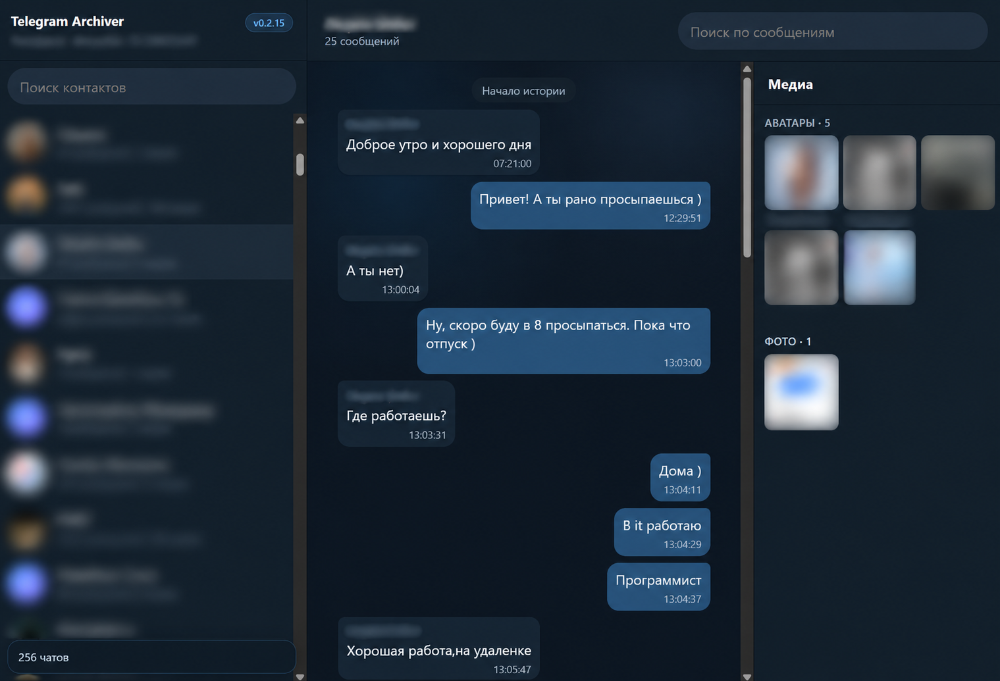

# Telegram Archiver

[English](README.md) · [Русский](README.ru.md)

A local archive of private Telegram chats.

The app syncs history and live updates through Telethon, stores messages in SQLite, indexes text with FTS5, and serves a web interface through FastAPI.



## Features

- Chats stay available locally even if they are deleted in Telegram
- Deleted messages remain in the local archive
- Edit history is kept
- Downloaded media stays on disk even if it is removed in Telegram
- Reading the archive does not send read receipts to Telegram
- Full-text search across the archive
- A web interface for chats, contacts, and history

## Run with Docker

```bash
docker-compose up --build
```

Then open:

```text
http://localhost:8085
```

## First sign-in

If the Telegram client is not set up yet, the app shows a sign-in form.

Create an application at [my.telegram.org/apps](https://my.telegram.org/apps), then enter:

- `api_id`
- `api_hash`
- phone number
- the code from Telegram
- the 2FA password, if it is enabled

History sync starts automatically after a successful sign-in.

## Run locally

```bash
python -m venv .venv
source .venv/Scripts/activate
pip install -r requirements.txt
python -m app.main
```

The interface is available at:

```text
http://localhost:8080
```

## CLI sign-in

To sign in without the web interface:

```bash
docker-compose run --rm -it app python -m app.auth
```

Locally:

```bash
python -m app.auth
```

## API

- `GET /api/chats`
- `GET /api/chats/{chat_id}/messages?offset=0&limit=50`
- `GET /api/search?q=text`
- `GET /media/{path}`
